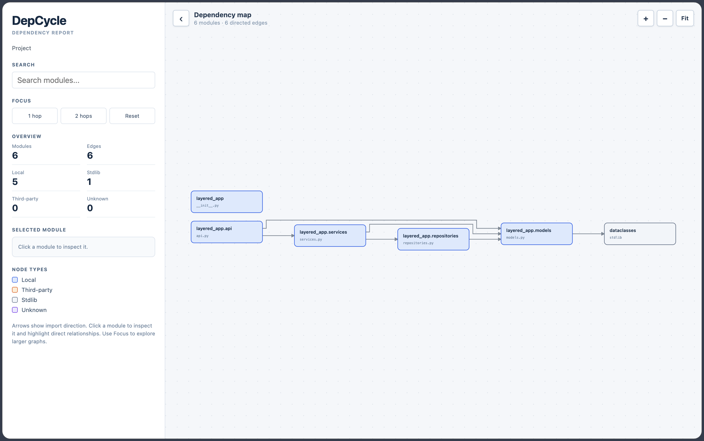
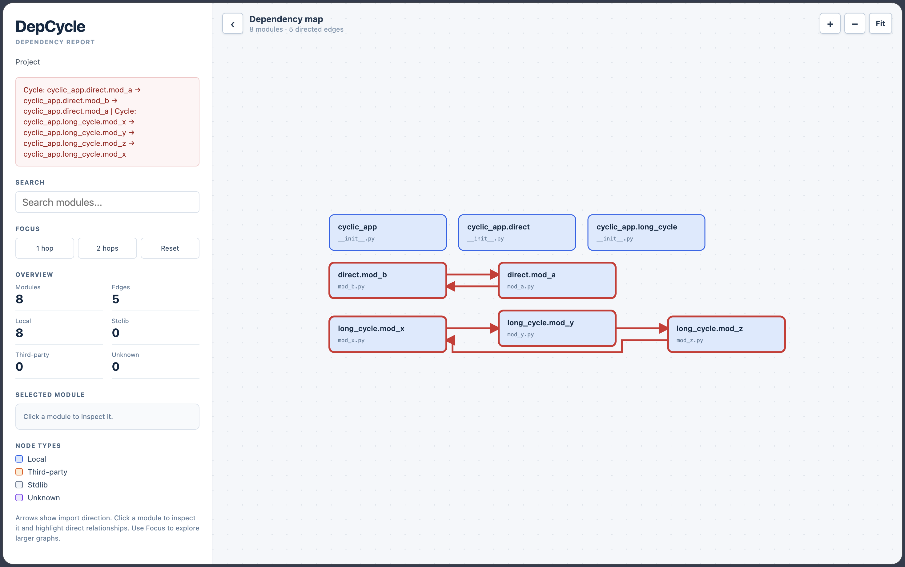
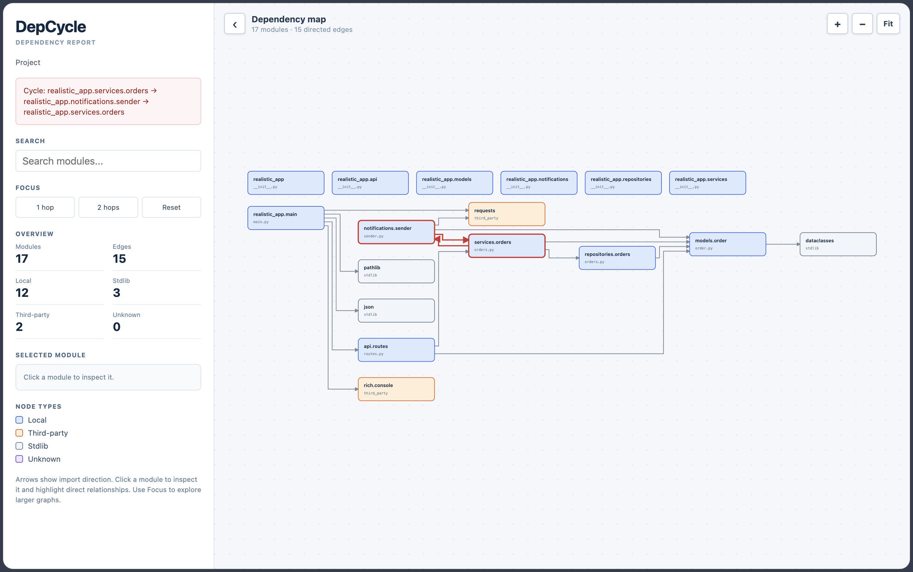
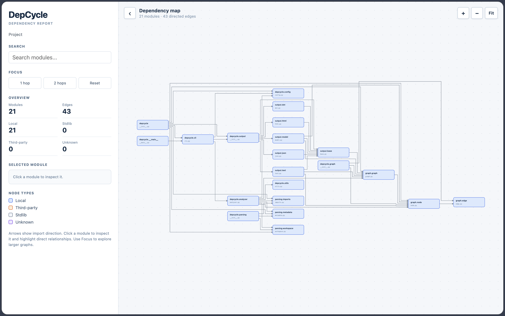

# DepCycle

[](https://pypi.org/project/depcycle/)
[](https://pypi.org/project/depcycle/)
[](https://pepy.tech/projects/depcycle)
[](https://github.com/Matricess/depcycle/actions/workflows/ci.yaml)
[](https://opensource.org/licenses/MIT)

DepCycle is a command-line tool for understanding dependencies between Python modules. It scans Python source files, extracts imports, builds a directed dependency graph, detects circular dependencies, and generates reports for visual exploration or further processing.

## Features

- Discover Python files while excluding common generated and environment paths.
- Build a graph of module dependencies.
- Detect circular dependency chains.
- Classify modules as local, standard-library, third-party, or unknown where possible.
- Export reports as interactive HTML, JSON, or Graphviz DOT.
- Filter third-party, standard-library, and unknown dependencies.
- Use JSON and DOT output in scripts and other tools.

Dependency classification is best-effort. A distribution name declared in project metadata may differ from the name used to import it in Python, so some imports may remain classified as unknown.

## See DepCycle in action

The reports below are generated from the example projects in this repository. DepCycle natively generates HTML, JSON, and DOT files.

### Layered dependencies

A small application with dependencies flowing between layers.

[Interactive HTML](docs/generated/layered_app.html) · [JSON](docs/generated/layered_app.json) · [DOT](docs/generated/layered_app.dot)



### Circular dependencies

Demonstrates a direct cycle and a longer circular dependency chain.

[Interactive HTML](docs/generated/cyclic_app.html) · [JSON](docs/generated/cyclic_app.json) · [DOT](docs/generated/cyclic_app.dot)



### A realistic project

A larger multi-package example containing an intentional circular dependency.

[Interactive HTML](docs/generated/realistic_app.html) · [JSON](docs/generated/realistic_app.json) · [DOT](docs/generated/realistic_app.dot)



### DepCycle analyzing itself

These reports show DepCycle's own module dependency graph.

[Interactive HTML](docs/generated/depcycle.html) · [JSON](docs/generated/depcycle.json) · [DOT](docs/generated/depcycle.dot)



## Example projects

The [`examples/`](examples/) directory contains five projects, progressing from simple imports to a more involved application.

| Example | Demonstrates |
| --- | --- |
| [`basic_app`](examples/basic_app/) | Basic local imports and one-way dependencies |
| [`layered_app`](examples/layered_app/) | A layered application structure |
| [`mixed_dependencies`](examples/mixed_dependencies/) | Local, standard-library, and third-party imports |
| [`cyclic_app`](examples/cyclic_app/) | Direct and multi-module circular dependencies |
| [`realistic_app`](examples/realistic_app/) | A larger multi-package example with an intentional cycle |

Generated reports for all five examples are available under [`docs/generated/`](docs/generated/). Each example has HTML, JSON, and DOT output.

## Installation

Install the published release from PyPI:

```bash
python -m pip install depcycle
```

Check the CLI:

```bash
depcycle --help
```

> **Development version:** the code in this repository may contain changes that are not yet included in the published PyPI release. To run the checked-out source, see [Development](#development).

## Quick start

Analyze a Python project and generate the default HTML report:

```bash
depcycle analyze /path/to/your/project
```

By default, DepCycle writes `dependencies.html` to the current working directory. Open it in a browser to explore the dependency graph.

Choose the output format and destination explicitly:

```bash
depcycle analyze /path/to/your/project --format html --output dependencies.html
depcycle analyze /path/to/your/project --format json --output dependencies.json
depcycle analyze /path/to/your/project --format dot --output dependencies.dot
```

If `--format` is omitted, DepCycle infers the format from a recognized output filename extension. If it cannot infer a format, it defaults to HTML. Use `-` as the output path to write the report to standard output:

```bash
depcycle analyze /path/to/your/project --format json --output -
```

## Output formats

### HTML

The HTML report provides an interactive dependency map for exploring module relationships and circular dependencies.


### JSON

JSON output is suitable for scripts and other tools. It contains project information, nodes, edges, detected cycles, and summary statistics, including fan-in, fan-out, and isolated-module counts.

```bash
depcycle analyze /path/to/your/project --format json --output dependencies.json
```

### DOT

DOT output is a text-based graph description that can be used by compatible tools and workflows. DepCycle writes DOT source; it does not itself generate PNG or SVG graph images.

```bash
depcycle analyze /path/to/your/project --format dot --output dependencies.dot
```

## Inspect modules and cycles

Inspect a particular module:

```bash
depcycle inspect /path/to/your/project my_package.service
```

List circular dependencies in a project:

```bash
depcycle inspect /path/to/your/project --cycles
```

Inspection results are printed as JSON. The `query` subcommand is retained as a legacy command; `inspect` is the recommended interface.

## Circular dependencies and CI

DepCycle reports detected cycles during analysis. Use `--fail-on-cycles` to exit with status `1` when at least one cycle is found:

```bash
depcycle analyze /path/to/your/project --fail-on-cycles
```

This is useful in CI workflows where detected cycles should fail a check.

## Filtering the graph

Hide third-party dependencies:

```bash
depcycle analyze /path/to/your/project --no-third-party
```

Hide standard-library modules:

```bash
depcycle analyze /path/to/your/project --no-stdlib
```

Hide unknown dependencies:

```bash
depcycle analyze /path/to/your/project --no-unknown
```

Combine filters to focus on local dependencies:

```bash
depcycle analyze /path/to/your/project --no-third-party --no-stdlib --no-unknown
```

DepCycle excludes common generated and environment paths by default, including virtual environments, `__pycache__`, version-control directories, build output, tests, examples, and migrations. Add exclusion patterns with `-e` or `--exclude`; the option can be repeated:

```bash
depcycle analyze /path/to/your/project --exclude tests --exclude 'generated/*.py'
```

Use `--include-all` to disable the built-in exclusion patterns and rely only on patterns explicitly supplied for that run:

```bash
depcycle analyze /path/to/your/project --include-all --exclude generated
```

## Project configuration

DepCycle reads supported settings from the `[tool.depcycle]` section of a project's `pyproject.toml`. For example:

```toml
[tool.depcycle]
exclude = ["generated", "docs"]
show_third_party = true
show_stdlib = true
show_unknown = true
fail_on_cycles = false
```

For third-party dependency recognition, DepCycle can read declared dependencies from `pyproject.toml`, `requirements.txt`, `requirements-*.txt`, `setup.cfg`, `setup.py`, and `Pipfile`.

## Development

This repository uses `uv` and the Makefile for development tasks. From the repository root, install the development environment and check the CLI:

```bash
make install
uv run depcycle --help
```

Common development commands:

```bash
make format
make lint
make typecheck
make test
make coverage
make check
make build
```

Regenerate an example report using the checked-out source:

```bash
uv run depcycle analyze examples/basic_app --format html --output docs/generated/basic_app.html
```

## Requirements

DepCycle supports Python 3.10 and newer.

## License

DepCycle is licensed under the MIT License. See [`LICENSE`](LICENSE) for the full license text.
